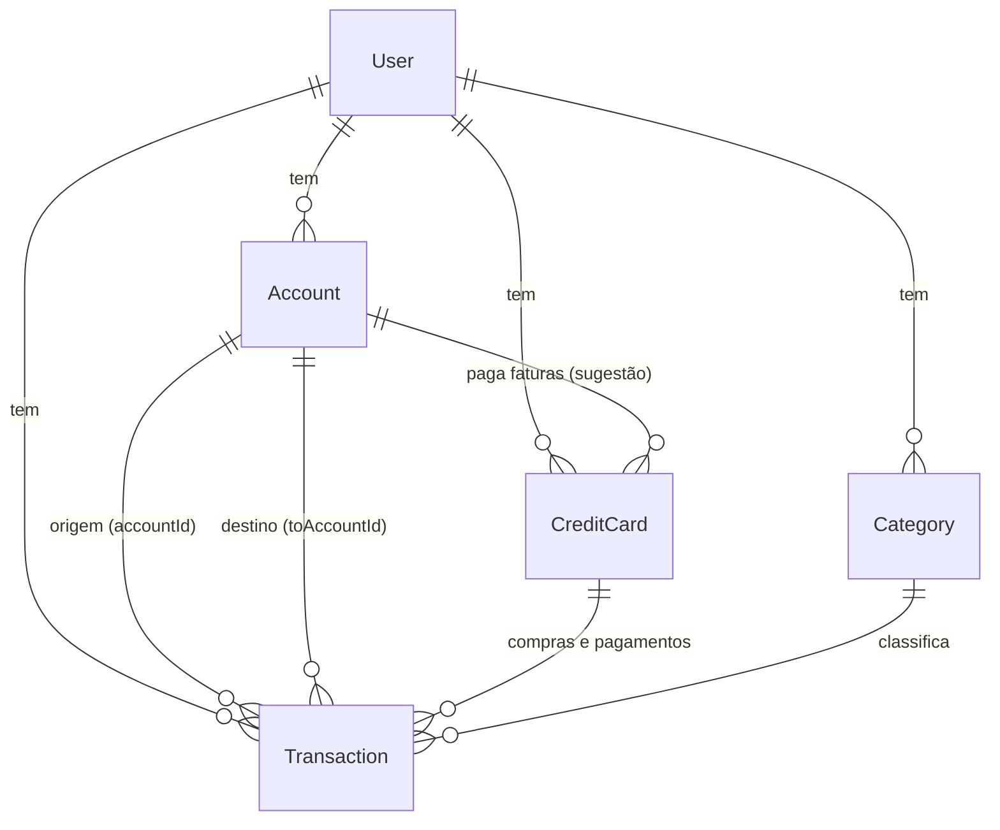

# Arquitetura e contexto do projeto

Documento para quem vai continuar o projeto (pessoa ou IA). Explica o que o app é, como o
código está organizado, as regras de negócio e as decisões já tomadas. O que falta construir
está em [ROADMAP.md](../ROADMAP.md).

## O que é

App web de finanças pessoais para uma pessoa controlar contas bancárias, cartões de crédito,
receitas e despesas. As funcionalidades foram definidas a partir de apps do mercado (como o
Mobills), olhando só as telas; código, marca e visual são próprios.

Público: uso pessoal, um usuário por conta, sem planos pagos. Interface em português (pt-BR),
moeda real (BRL), fuso `America/Sao_Paulo`.

## Stack

| Camada | Escolha | Observação |
|---|---|---|
| Framework | Next.js 16 (App Router) | `cacheComponents` e `partialPrefetching` ligados |
| UI | React 19, Tailwind CSS 4, lucide-react, Recharts | Classes utilitárias próprias em `globals.css` (`.card`, `.field`, `.btn-primary`, `.btn-ghost`) |
| Banco | PostgreSQL 17 (Docker, porta **5433**) | A 5432 da máquina original já estava em uso |
| ORM | Prisma **7.10.1** com `@prisma/adapter-pg` | Client gerado em `src/generated/prisma` (fora do git) |
| Sessão | iron-session (cookie criptografado) | Sem biblioteca de auth; senha com bcryptjs |
| Validação | zod 4 | Toda entrada de formulário passa por um schema |

## Como rodar

Ver [README.md](../README.md#rodando-localmente). Resumo: `npm install`, `npm run db:up`,
`npm run db:migrate`, `npm run db:seed` (opcional), `npm run dev`.

Usuário de demonstração criado pelo seed: `demo@financas.test` / `demo-financas-123`.

## Estrutura de pastas

```
prisma/
  schema.prisma        modelos do banco
  migrations/          migrações (nunca editar uma já aplicada)
  seed.ts              usuário demo com um mês de dados
src/
  proxy.ts             redireciona para /login quem não tem cookie (antigo middleware)
  app/
    layout.tsx         raiz (fontes, lang pt-BR)
    globals.css        tema e classes utilitárias
    (auth)/            login, cadastro e suas server actions
    (app)/             telas autenticadas
      layout.tsx       menu lateral/inferior + menu do usuário
      actions.ts       TODAS as mutações das telas autenticadas
      page.tsx         Início (dashboard)
      contas/ transacoes/ cartoes/ categorias/
  components/          componentes compartilhados (menu, navegação de mês, cards, gráfico)
  lib/
    db.ts              instância única do Prisma
    session.ts         ler/criar/apagar o cookie de sessão
    auth.ts            requireUser(): a porta de entrada de toda leitura e escrita
    finance.ts         saldos de contas e totais do mês
    cards.ts           regras de fatura e limite dos cartões
    dates.ts           meses, intervalos e formatação de datas
    money.ts           centavos ↔ texto em reais
    labels.ts          rótulos em português dos enums
```

## Modelo de dados



- **Valores em centavos** (`Int`) em todo lugar: `amount`, `initialBalance`, `limit`.
  Converter só na borda com `parseCents` / `formatCents` / `centsToInput`.
- **Datas de transação são dias** (`@db.Date`), guardadas como meia-noite UTC. Nunca usar
  `new Date()` local para montar uma data de transação; usar `parseISODate("AAAA-MM-DD")`.
- `Transaction.type`:
  - `INCOME` / `EXPENSE`: receita e despesa, com categoria opcional.
  - `TRANSFER`: sai de `accountId`, entra em `toAccountId`; sem categoria.
  - `CARD_PAYMENT`: pagamento de fatura; sai de `accountId`, ligado a `creditCardId` + `invoiceMonth`.
- Compra no cartão = `EXPENSE` com `creditCardId` e `invoiceMonth`, e **`accountId` vazio**.
- Exclusões: apagar conta ou cartão apaga as transações ligadas (cascade); apagar categoria deixa
  as transações "Sem categoria" (set null).

## Regras de negócio

### Saldos (`src/lib/finance.ts`)

- **Saldo atual** da conta = saldo inicial + receitas − despesas − transferências enviadas
  + transferências recebidas − pagamentos de fatura, contando só lançamentos **efetivados** com
  data **até hoje**.
- **Saldo previsto** = mesma conta, incluindo pendentes, até o fim do mês selecionado.
- **Receitas/despesas do mês** = soma de `INCOME`/`EXPENSE` com data no mês, efetivadas ou não.
  Compras no cartão entram aqui pela data da compra. Transferências e pagamentos de fatura não entram.

### Cartões e faturas (`src/lib/cards.ts`)

- A fatura é identificada pelo **mês em que fecha** (`invoiceMonth` = dia 1 desse mês).
- Compra antes do dia de fechamento → fatura que fecha no mesmo mês; no dia de fechamento ou
  depois → fatura do mês seguinte.
- Vencimento: no mesmo mês do fechamento se `dueDay > closingDay`, senão no mês seguinte.
- `invoiceMonth` é calculado e **gravado na compra**; mudar o fechamento do cartão não move compras antigas.
- Status: **paga** se pagamentos ≥ total; **fechada** se hoje ≥ data de fechamento; senão **aberta**.
- Limite usado = soma das compras − soma dos pagamentos, em todas as faturas.
- Dias de fechamento e vencimento ficam entre 1 e 28 para existirem em todo mês.
- O `prisma/seed.ts` repete a regra de fatura (não pode importar `cards.ts` por causa do
  `server-only`); se mudar a regra, mude nos dois.

## Padrões do código

**Autenticação.** `proxy.ts` só checa se o cookie existe. Quem valida de verdade é
`requireUser()` em `src/lib/auth.ts`, que redireciona para `/login`. Toda página que lê dados e
toda server action começa com `const user = await requireUser()`.

**Isolamento por usuário.** Toda consulta filtra por `userId: user.id`. Em updates e deletes use
`updateMany` / `deleteMany` com `{ id, userId }` (nunca `update({ where: { id } })` direto com um
id vindo do formulário). IDs de conta, cartão e categoria vindos do formulário são conferidos
antes de gravar.

**Mutações.** Ficam em `src/app/(app)/actions.ts` (e `(auth)/actions.ts`). Padrão:
validar com zod → conferir dono → gravar → `redirect(...)` (formulários de página inteira) ou
`refresh()` de `next/cache` (ações dentro de listas). Formulários com erro usam
`useActionState` em um componente cliente e recebem `{ error?: string }`.

**Páginas com Cache Components.** Com `cacheComponents: true`, qualquer leitura de cookie,
`searchParams`, `params` ou da hora atual precisa estar dentro de `<Suspense>`. O padrão de
todas as telas é:

```tsx
export default function Page({ searchParams }: PageProps<"/rota">) {
  return (
    <div>
      <h1>Título estático</h1>
      <Suspense fallback={<Esqueleto />}>
        <Conteudo searchParams={searchParams} />
      </Suspense>
    </div>
  );
}

async function Conteudo({ searchParams }: { searchParams: PageProps<"/rota">["searchParams"] }) {
  const params = await searchParams;
  const user = await requireUser();
  // consultas...
}
```

- `getSessionUserId()` chama `await connection()` antes de ler o cookie, porque o iron-session
  usa `Date.now()`; sem isso o Next acusa erro de prerender.
- O menu usa `usePathname()` dentro de `<Suspense>` pelo mesmo motivo.
- Os tipos `PageProps<"/rota">` são gerados pelo Next (`npx next typegen` ou ao rodar dev/build).

**Mês selecionado.** Telas mensais leem `?mes=AAAA-MM` com `parseMonth()` (padrão: mês atual);
a fatura usa `?fatura=AAAA-MM`. O componente `MonthNav` monta os links de anterior/próximo.

**Visual.** Cor principal teal (`teal-700`), fundo `slate-100`, cartões brancos arredondados.
Verde para receita, vermelho para despesa, violeta para cartão. Textos da interface em português.

## Como adicionar uma tela nova (exemplo: Orçamentos)

1. Modelo em `prisma/schema.prisma` → `npm run db:migrate -- --name orcamentos`
   (gera a migração e o client).
2. Regras e consultas em `src/lib/<assunto>.ts` com `import "server-only"`.
3. Server actions em `src/app/(app)/actions.ts`, seguindo o padrão acima.
4. Página em `src/app/(app)/<rota>/page.tsx` com o padrão de Suspense; formulário cliente
   ao lado (`<nome>-form.tsx`).
5. Item no menu em `src/components/nav.tsx` (ajustar `grid-cols-N` do menu inferior).
6. Dados de exemplo em `prisma/seed.ts`.
7. Conferir: `npx tsc --noEmit`, `npm run lint`, `npm run build` e o fluxo no navegador.

## Armadilhas conhecidas

- **Next.js 16 mudou muita coisa.** Antes de usar uma API do Next, ler o guia em
  `node_modules/next/dist/docs/` (ver `AGENTS.md`). Ex.: `middleware` virou `proxy`;
  `params`/`searchParams`/`cookies()` são assíncronos.
- **Prisma fixado em 7.10.1.** A tag `latest` do npm aponta para um RC da versão 8; não atualizar
  sem decidir migrar. CLI (`prisma`) e client (`@prisma/client`, `@prisma/adapter-pg`) na mesma versão.
- **Depois de mudar o schema**, reiniciar o `next dev`: a instância do Prisma fica guardada em
  `globalThis` e não enxerga modelos novos.
- **`prisma init` instala "skills" de IA** em `.agents/`, `.claude/`, `.windsurf/`; foram removidas.
- **Porta do banco é 5433**, não 5432.
- **Sem testes automatizados ainda** (ver ROADMAP, item 7). Validar no navegador com o usuário demo.

## Decisões e por quê

| Decisão | Motivo |
|---|---|
| Centavos inteiros | Evita erro de arredondamento de ponto flutuante |
| `@db.Date` em UTC | Transação é um dia de calendário; evita "pular" de dia por fuso |
| Compra no cartão sem `accountId` | Compra não mexe no saldo; só o pagamento da fatura mexe |
| `CARD_PAYMENT` como tipo próprio | Pagar fatura não pode contar como despesa de novo |
| `invoiceMonth` gravado | Mudar o fechamento do cartão não reorganiza o passado |
| iron-session em vez de NextAuth | App de um usuário com e-mail e senha; menos peças |
| Todas as actions num arquivo | Projeto pequeno; fica fácil auditar o isolamento por usuário |
